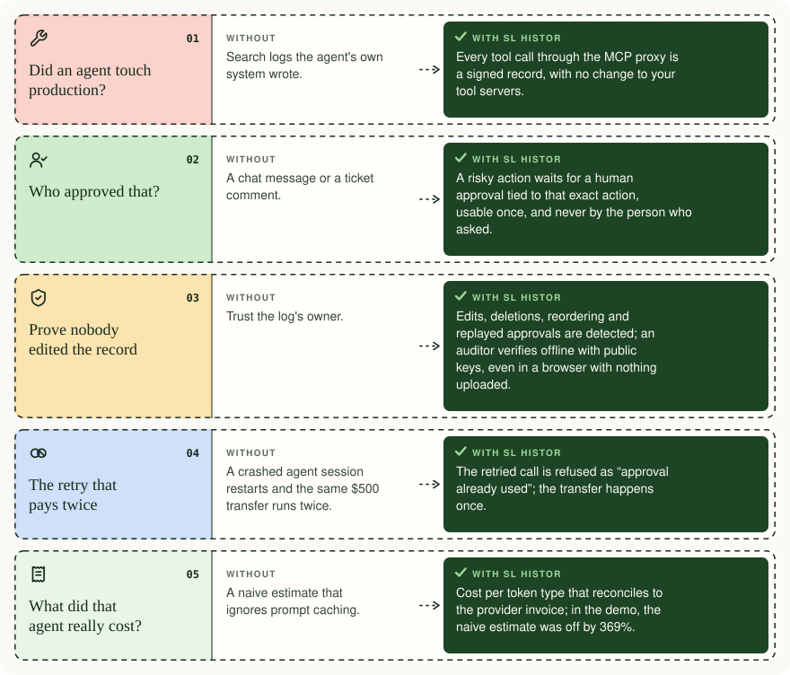

# SL Histor

**Independent, verifiable evidence of what your AI agents did, who approved it, and what it truly cost.** By [SinewsLink](https://sinewslink.com).

In Homer, the *histor* is the trusted witness whose account settles a dispute. Gateways answer *"can this happen?"* and observability answers *"why did it break?"*. SL Histor answers the auditor: **"what did your agents do, who approved it, and can you prove it?"** It sits beside your stack, never in your traffic path.

## How SL Histor helps

<p align="center">
  
</p>

<details>
<summary>Read the five situations as text</summary>

| Situation | Without | With SL Histor |
|---|---|---|
| **Did an agent touch production?** | Search logs the agent's own system wrote. | Every tool call through the MCP proxy is a signed record, with no change to your tool servers. |
| **Who approved that?** | A chat message or a ticket comment. | A risky action waits for a human approval tied to that exact action, usable once, and never by the person who asked. |
| **Prove nobody edited the record** | Trust the log's owner. | Edits, deletions, reordering and replayed approvals are detected; an auditor verifies offline with public keys, even in a browser with nothing uploaded. |
| **The retry that pays twice** | A crashed agent session restarts and the same $500 transfer runs twice. | The retried call is refused as "approval already used"; the transfer happens once. |
| **What did that agent really cost?** | A naive estimate that ignores prompt caching. | Cost per token type that reconciles to the provider invoice; in the demo, the naive estimate was off by 369%. |

</details>

## How it works

<p align="center">
  
</p>
<p align="center"><sub><a href="docs/assets/sl-histor-architecture-fr.svg">Version française du schéma</a></sub></p>

**Built on open standards.** Receipts are canonicalized with [RFC 8785](https://www.rfc-editor.org/rfc/rfc8785), signed with Ed25519 ([RFC 8032](https://www.rfc-editor.org/rfc/rfc8032)), chained by hash and batched into Merkle trees with inclusion proofs ([RFC 9162](https://www.rfc-editor.org/rfc/rfc9162), the design behind Certificate Transparency). Histor works where agents already run, the [Model Context Protocol](https://modelcontextprotocol.io) and Claude Code hooks, and exports to [W3C Verifiable Credentials](https://www.w3.org/TR/vc-data-model-2.0/) so evidence is never locked in. OpenTelemetry GenAI mapping is documented in `docs/04-otel-mapping.md`; the exporter is in progress.

**What it adds that logs and traces don't:** approvals bound to the exact payload and usable once, with separation of duties; keyed commitments so receipts prove what happened without holding the data; cost per token bucket reconciled to the provider invoice; and detection of edited, deleted or replayed actions.

```
$ npm run demo
1) low-consequence read: ok
2) destructive call, no approval yet → blocked, request created
3) the operator approves their own request → rejected (separation of duties)
4) a different human approves that exact payload → executed, once
5) payload swapped after approval → blocked
6) approved call replayed → blocked (single use)
7) every receipt signed and chained; stream closed with a terminal receipt
8) Merkle root ready to anchor; inclusion proof verifies
9) edited receipt detected · deleted receipt detected
10) cached agent turn priced correctly vs naive → naive is off by 369%
```

## What each record holds
Every agent action becomes one signed record: who, what, under what authority, the outcome and the cost. The raw content stays out.
- **Who:** the person the agent acts for and how they were identified, the agent, and the session.
- **What:** the tool and server called, and when.
- **What was sent and returned, without the content:** a keyed commitment of the arguments and the result. Anyone holding the original data can prove it matches; the record alone reveals nothing, so secrets and personal data stay out of the evidence trail.
- **Authority:** the policy rule and risk level that applied and, for risky actions, who approved that exact payload, that the approval was used once, and that the approver was not the requester.
- **Outcome:** executed or blocked, and why. Refusals are evidence too.
- **Warning signs:** leaked secrets, tampered tool descriptions, tools whose definitions changed since they were last seen, and agents stuck in a loop.
- **Cost, for model calls:** tokens by bucket (input, output, cache reads, cache writes), priced in exact decimals and reconcilable to the provider invoice.
- **Tamper evidence:** sequence number, hash link to the previous record, and an Ed25519 signature. Run `histor signer` and the signing key sits in a separate process the agent cannot reach. Editing, deleting or reordering anything breaks verification.

Sessions also get opening and closing records, so a truncated log is detectable, and Histor records its own gaps rather than staying silent.

## What's in the box
| Package | What it does |
|---|---|
| `packages/histor-core` | Zero-dependency core: RFC 8785 canonicalization, keyed commitments, Ed25519 seals, hash-chained ledger (multi-process safe), terminal markers, in-chain key rotation, RFC 9162 Merkle batches and proofs, verifier with out-of-band witness, exact-decimal cost engine, secret and tool-poisoning scanners, loop detection, policy and approval binding, out-of-process signer, export to W3C Verifiable Credentials |
| `packages/mcp-proxy` | `histor-mcp-proxy`: wraps **any** stdio MCP server with no code change |
| `packages/claude-code-hook` | `histor-claude-hook`: Claude Code PreToolUse / PostToolUse / Stop / SessionEnd |
| `packages/cli` | `histor`: init · pending · approve · deny · inspect · verify · seal · prove · export · rotate · signer · serve · cost · reconcile |
| `web-verifier/` | One self-contained HTML page: drop in receipts and a keyring, and verify in the browser with nothing uploaded |
| `spec/` | Histor receipt format v0.1, JSON Schemas, signed examples, conformance vectors (positive + MUST-reject) |
| `docs/` | Integration guide, compliance and OpenTelemetry mappings, edge-case checklist |
| `examples/goose-crash-test/` | Crash test with goose: a durable-execution retry moves the same $500 twice without Histor, once with it |
| `.claude/skills/` | Claude skills for building integrations and evolving the spec safely (Claude Code loads them automatically in this repo) |

## Quickstart
```
git clone https://github.com/SinewsLink/histor && cd histor
npm install && npm test && npm run demo
npx histor init                      # keys, config and a starter policy in .histor/
npx histor serve                     # local viewer at http://127.0.0.1:7337
```
Wrap an MCP server or add the Claude Code hook: see [docs/05-integration-guide.md](docs/05-integration-guide.md). For production, run `histor signer` so the signing key never sits in the agent's process.

## Measured overhead
`npm test` runs a benchmark that fails CI on regression. On GitHub's Linux runners the median is under **1 ms** to commit, scan and seal a receipt in memory, and under **2 ms** for a durable (fsync'd) append.

## Status and licence
v0.2.0, a working reference implementation of the Histor receipt spec v0.1, with 33 tests. Apache-2.0. © 2026 SinewsLink Inc. See NOTICE for third-party credits. Commercial SL Histor (self-hosted ledger, approvals app, auditor portal, framework packs, invoice reconciliation) is available from SinewsLink.
